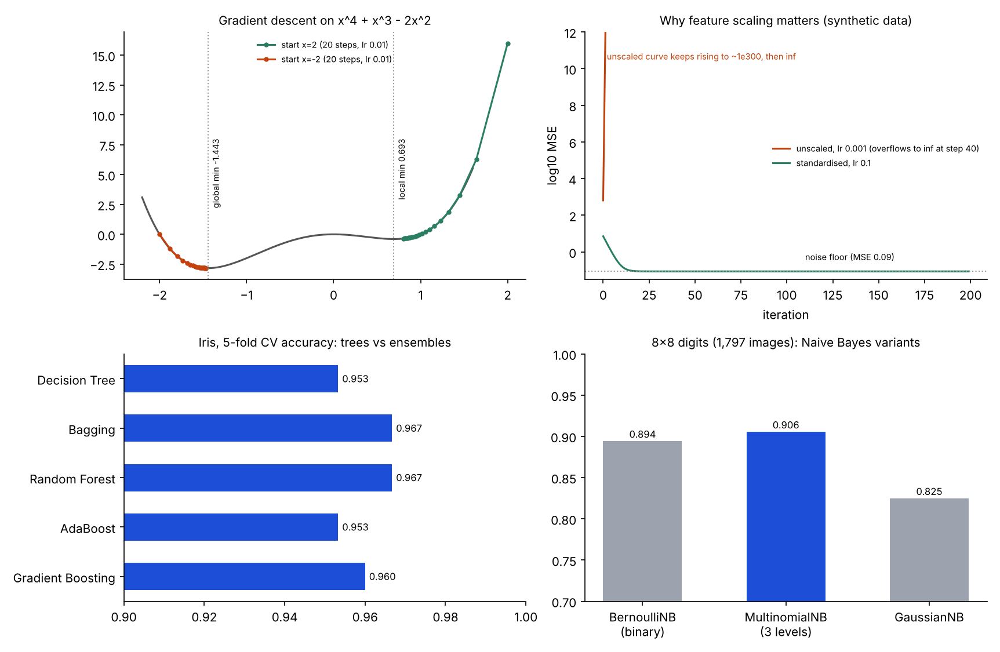

# ML Fundamentals From Scratch

Classical machine-learning building blocks written by hand and checked against reference implementations: k-nearest neighbours, gradient descent, ordinary least squares, categorical Naive Bayes with Laplace smoothing, plus tree-ensemble and Naive Bayes comparisons on small public datasets. Course homework, collected into one reproducible repo.



## Results (all re-run for this repo, seeded)

| Module | Result |
|---|---|
| `knn_scratch.py` | My NumPy KNN and scikit-learn both score **0.9778** on a stratified 70/30 Iris split (k=5, uniform and distance weighting). 5-fold CV: 0.9733 +- 0.0249 (mine) vs 0.9667 +- 0.0298 (sklearn) |
| `ensembles_iris.py` | 5-fold CV on Iris: Decision Tree 0.953, Bagging 0.967, Random Forest 0.967, AdaBoost 0.953, Gradient Boosting 0.960 |
| `digits_naive_bayes.py` | 8x8 digits, 80/20: BernoulliNB 0.894, MultinomialNB (3 grey levels) **0.906**, GaussianNB 0.825 |
| `naive_bayes_laplace.py` | Synthetic loan data: 0.690 with and without smoothing, **equal to the 0.690 majority-class baseline** |
| `gradient_descent.py` | Univariate: paths from x=2 and x=-2 reach 0.806 and -1.466 after 20 steps; true minima are 0.693 (local) and -1.443 (global) |
| `ols_normal_equation.py` | Closed-form OLS matches `numpy.linalg.lstsq` on seeded data |

## Things worth knowing

- **KNN:** both implementations make the same single mistake (one virginica predicted as versicolor). The from-scratch version predicts in about the same time as scikit-learn on 45 test points; timings on this size are noise, not a speed claim.
- **Naive Bayes loan data:** the labels are generated independently of the features, so no classifier can beat the majority class. 0.690 is the base rate, not evidence the model learned anything, and smoothing cannot help when the test set has no unseen feature values.
- **Digits are not MNIST:** `load_digits` is the 8x8, 1,797-image UCI digits set. The notebook called it MNIST; it is not the 28x28 MNIST used in [mnist-lenet5-and-naive-bayes](https://github.com/vrushabh05/mnist-lenet5-and-naive-bayes).
- **Gradient descent, univariate:** the original write-up said the two paths end near 0.58 and -1.2. Re-running gives 0.806 and -1.466 after 20 steps at lr 0.01; the real stationary points are x=-1.443 (global minimum, f=-2.833), x=0 (local maximum) and x=0.693 (local minimum, f=-0.397). Starting right of the hump lands in the local minimum; starting left lands in the global one.
- **Gradient descent, regression:** the original run on California housing (MedInc and Population, unscaled, lr 0.001) overflowed to infinity around iteration 40, so its train/test MSE were `inf` and the written "slight overfitting" verdict was not meaningful. Housing cannot be downloaded in this environment, so `gradient_descent.py` demonstrates the same failure on **seeded synthetic data with a similar scale mismatch** and shows that standardising the features and raising the learning rate converges to the noise floor (MSE 0.087 vs 0.09 true noise). This is a demonstration, not a reproduction of the housing result.
- **Ensembles:** the original notebook's prose quoted ranges (e.g. 0.93 to 0.96) that do not match its own printed CV scores; the table above uses the printed and re-run values. Differences of 0.01 on 150 samples are within fold-to-fold noise (std about 0.02-0.03).

## Recorded from the original notebooks (data not included, not re-run here; see `notebooks/` for the saved outputs)

- **Housing EDA** (`src/housing_eda.py`): median house value is right-skewed with a hard cap at $500,000; median income vs value correlation is about 0.69; total rooms, bedrooms, households and population are strongly inter-correlated (0.91 to 0.98); latitude and longitude correlate at -0.92; coastal categories have higher prices.
- **OLS on hours studied vs exam score** (25 rows): intercept 2.4837, slope 9.7758.

## Run it

```bash
pip install numpy pandas scikit-learn matplotlib seaborn
python src/knn_scratch.py
python src/ensembles_iris.py
python src/digits_naive_bayes.py
python src/naive_bayes_laplace.py
python src/gradient_descent.py
python src/ols_normal_equation.py
python make_chart.py
```

Each script writes its JSON to `results/`.

## Files

| File | Purpose |
|---|---|
| `src/knn_scratch.py` | `MyKNN` (vectorised distances, uniform / distance voting) vs scikit-learn |
| `src/ensembles_iris.py` | Tree, bagging, random forest, AdaBoost, gradient boosting |
| `src/digits_naive_bayes.py` | Bernoulli / Multinomial / Gaussian NB on 8x8 digits |
| `src/naive_bayes_laplace.py` | Categorical NB from scratch with Laplace smoothing |
| `src/gradient_descent.py` | Univariate descent and multiple linear regression by gradient descent |
| `src/ols_normal_equation.py` | Normal-equation least squares |
| `src/housing_eda.py` | California housing exploration (needs the CSV) |
| `results/` | Outputs of the scripts |

## Notebooks

The original assignment notebooks, with their saved outputs and figures, are included.

| Notebook | Topic |
|---|---|
| [`HW1_Que6_housing_EDA.ipynb`](notebooks/HW1_Que6_housing_EDA.ipynb) | California housing exploration (5 embedded figures) |
| [`HW2_Que6_tree_ensembles_iris.ipynb`](notebooks/HW2_Que6_tree_ensembles_iris.ipynb) | Decision tree vs ensembles on Iris |
| [`HW3_Que6_KNN_from_scratch.ipynb`](notebooks/HW3_Que6_KNN_from_scratch.ipynb) | KNN from scratch vs scikit-learn |
| [`HW4_naive_bayes_digits.ipynb`](notebooks/HW4_naive_bayes_digits.ipynb) | Naive Bayes variants on 8x8 digits |
| [`HW4_source_gradient_descent_and_naive_bayes.ipynb`](notebooks/HW4_source_gradient_descent_and_naive_bayes.ipynb) | Gradient descent (the diverging housing run) and Naive Bayes with Laplace smoothing |
| [`HW5_Que6_OLS_normal_equation.ipynb`](notebooks/HW5_Que6_OLS_normal_equation.ipynb) | Closed-form OLS |

Student identifiers and Colab account metadata were removed; code and outputs are unchanged.

## Stack

`Python` `NumPy` `pandas` `scikit-learn` `matplotlib` `seaborn`
